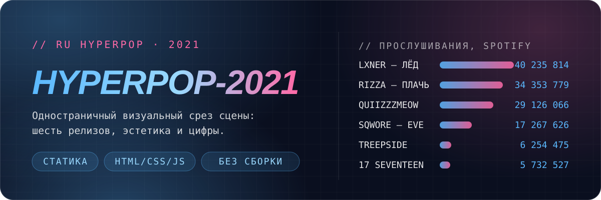
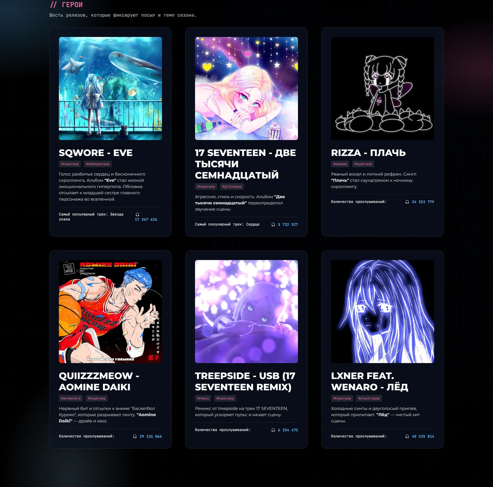
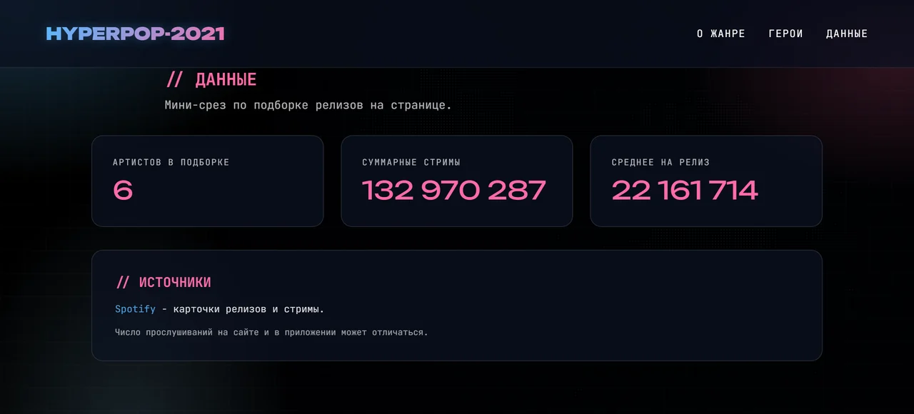
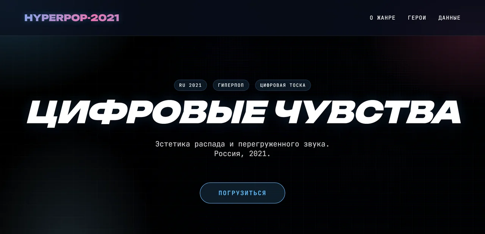

<p align="center">
  
</p>

Статичная страница, которая за один скролл объясняет, чем был русский гиперпоп в 2021 году:
шесть релизов сезона, эстетика распада и перегруженного звука, и цифры прослушиваний рядом с каждой обложкой.

Без фреймворков, без сборки, без зависимостей — `index.html`, `style.css`, `script.js`.

## // ГЕРОИ

Шесть релизов, которые фиксируют посыл и темп сезона. Каждая карточка — обложка, теги, короткий разбор
и число прослушиваний; клик по обложке открывает трек в Spotify.

<p align="center">
  
</p>

| Релиз | Теги | Прослушивания |
| --- | --- | ---: |
| [LXNER feat. WENARO — Лёд](https://open.spotify.com/track/7CMV5bdIXxN4SB0W6wzHDW) | `#hyperpop` `#electropop` | 40 235 814 |
| [RIZZA — Плачь](https://open.spotify.com/track/3yCKABoZU3FVFuyVBc5VlM) | `#emopop` `#hyperpop` | 34 353 779 |
| [QUIIZZZMEOW — Aomine Daiki](https://open.spotify.com/track/37yN0KkJCQ1d9vlxEjbBlX) | `#animecore` `#hyperpop` | 29 126 066 |
| [SQWORE — Eve](https://open.spotify.com/album/2NGJydCluoYwOcMIMgaHYC) | `#hyperpop` `#emohyperpop` | 17 267 626 |
| [TREEPSIDE — USB (17 SEVENTEEN Remix)](https://open.spotify.com/track/2feVO08HAtBx0zBqlyOGGO) | `#remix` `#hyperpop` | 6 254 475 |
| [17 SEVENTEEN — Две тысячи семнадцатый](https://open.spotify.com/album/3fqHBhY9PAiGj9gGuxPDRo) | `#hyperpop` `#glitchpop` | 5 732 527 |

## // ДАННЫЕ

Мини-срез по подборке. Числа зашиты в разметку (`data-count`) и досчитываются анимацией при попадании
блока в зону видимости.

<p align="center">
  
</p>

| Артистов в подборке | Суммарные стримы | Среднее на релиз |
| ---: | ---: | ---: |
| 6 | 132 970 287 | 22 161 714 |

Источник карточек и цифр — [Spotify](https://open.spotify.com/). Число прослушиваний на сайте
и в приложении может отличаться.

## // ЗАПУСК

Сборки нет. Клонируйте и откройте `index.html` в браузере:

```bash
git clone https://github.com/darkwhitezero/hyperpop-2021.git
```

Если фоновое видео не стартует само (политики автоплея в Chrome), поднимите
локальный сервер и зайдите на `http://localhost:8000`:

```bash
python -m http.server 8000
```

## // КАК УСТРОЕНО

```text
hyperpop-2021/
├── index.html      # вся разметка: герой, карточки релизов, блок данных
├── style.css       # токены, glass-компоненты, глитч и анимации
├── script.js       # счётчики на IntersectionObserver + параллакс карточек
└── assets/         # обложки релизов и фоновое видео
```

<p align="center">
  
</p>

Что делает страницу живой:

- **Видеофон с CRT-обработкой** — `grayscale(60%) contrast(115%)` плюс scanline-оверлей поверх.
- **Глитч-заголовок** — хроматическое смещение розовой и голубой тени по `:hover`.
- **Glass-карточки** — `backdrop-filter: blur(12px)` на полупрозрачном тёмно-синем слое.
- **Счётчики** — `IntersectionObserver` запускает `requestAnimationFrame`-досчёт при 50% видимости.
- **Параллакс** — карточки наклоняются за курсором до 5° через `perspective + rotateX/rotateY`.
- **Тикер и градиентный логотип** — бесконечные CSS-анимации без JS.

Доступность и адаптив: сетка перестраивается в одну колонку на `max-width: 768px`, все ссылки
и кнопки имеют `focus-visible`, а при `prefers-reduced-motion: reduce` анимации отключаются,
и счётчики сразу показывают конечные значения.

> [!NOTE]
> `assets/background.mp4` весит ~49 МБ — клон репозитория получится тяжёлым.

## // ДИЗАЙН-СИСТЕМА

Токены объявлены в `:root` внутри [`style.css`](style.css).

| Роль | Токен | Значение |
| --- | --- | --- |
| Фон страницы | `--bg-dark` | `#0a0f1f` |
| Акцент / ссылки | `--neon-blue` | `#5bb9ff` |
| Акцент / заголовки секций | `--neon-pink` | `#ff6aa7` |
| Светлый акцент | `--neon-cyan` | `#9ad9ff` |
| Стекло | `--glass-bg` | `rgba(12, 18, 34, 0.7)` |
| Граница стекла | `--glass-border` | `rgba(255, 255, 255, 0.12)` |
| Дисплейный шрифт | `--font-display` | Unbounded 700/900, italic uppercase |
| Основной шрифт | `--font-main` | Montserrat 400/800 |
| Технический шрифт | `--font-code` | JetBrains Mono, `letter-spacing: 0.12–0.2em` |

Радиусы: `16px` — стеклянные блоки, `8px` — обложки, `999px` — пилюли и кнопки, `4–6px` — теги.
Сетка фона — `32px`. Повторяющийся мотив — префикс `//` перед заголовками секций.

## // ЛИЦЕНЗИЯ

[MIT](LICENSE). Обложки и музыка принадлежат правообладателям и использованы как иллюстрация сцены.

<sub>Designed by <b>darkwhitezero</b> — 18.01.2026</sub>
