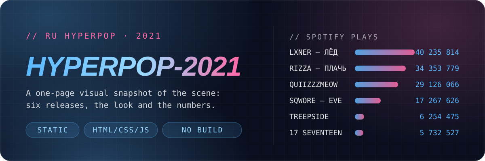

<p align="center">
  
</p>

<p align="center">
  <b>English</b> · <a href="README.ru.md">Русский</a>
  <br>
  <a href="https://darkwhitezero.github.io/hyperpop-2021/"><b>Open the live site →</b></a>
</p>

A static page that explains, in one scroll, what Russian hyperpop sounded and looked like in 2021:
six releases from that season, the falling-apart aesthetic and overloaded sound, and a play count next to every cover.

Some context if the scene is new to you: around 2020 and 2021 a wave of young Russian artists picked up hyperpop
(pitched-up, heavily Auto-Tuned vocals over blown-out, glitchy production) and crossed it with emo-pop and anime references.
It spread mostly online, and some of these tracks went on to tens of millions of Spotify plays.
The six artists here are LXNER, RIZZA, QUIIZZZMEOW, SQWORE, TREEPSIDE and 17 SEVENTEEN.
The lyrics and the site are in Russian, but the mood comes through without a translation.

There are no frameworks, no build step and no dependencies: just `index.html`, `style.css` and `script.js`.

## // HEROES

Six releases that capture the message and the pace of the season. Each card has a cover, tags, a short write-up
and a play count, and clicking the cover opens the track in Spotify.

<p align="center">
  
</p>

| Artist | Release | Tags | Spotify plays |
| --- | --- | --- | ---: |
| LXNER feat. WENARO | [Лёд](https://open.spotify.com/track/7CMV5bdIXxN4SB0W6wzHDW) *(Ice)* | `#hyperpop` `#electropop` | 41,817,402 |
| RIZZA | [Плачь](https://open.spotify.com/track/3yCKABoZU3FVFuyVBc5VlM) *(Cry)* | `#emopop` `#hyperpop` | 35,931,065 |
| QUIIZZZMEOW | [Aomine Daiki](https://open.spotify.com/track/37yN0KkJCQ1d9vlxEjbBlX) | `#animecore` `#hyperpop` | 29,993,577 |
| SQWORE | [Eve](https://open.spotify.com/album/2NGJydCluoYwOcMIMgaHYC)¹ | `#hyperpop` `#emohyperpop` | 17,886,387 |
| TREEPSIDE | [USB (17 SEVENTEEN Remix)](https://open.spotify.com/track/2feVO08HAtBx0zBqlyOGGO) | `#remix` `#hyperpop` | 6,425,083 |
| 17 SEVENTEEN | [Две тысячи семнадцатый](https://open.spotify.com/album/3fqHBhY9PAiGj9gGuxPDRo)¹ *(Two Thousand Seventeen)* | `#hyperpop` `#glitchpop` | 5,960,671 |

Counts as of October 19, 2026, taken from [`assets/data/playcounts.json`](assets/data/playcounts.json).
A GitHub Actions job refreshes that file once a day, so the [live site](https://darkwhitezero.github.io/hyperpop-2021/)
shows the latest numbers.

<sub>¹ For the two album cards the site shows the plays of one track: "Звезда упала" for SQWORE and "Сердце" for 17 SEVENTEEN.</sub>

## // DATA

A small summary of the selection. Fallback values are hard-coded in the markup (`data-count`). On load, `script.js`
fetches `assets/data/playcounts.json`, recalculates the total and the average, and counts them up with an animation
once the block scrolls into view.

<p align="center">
  
</p>

| Artists in the selection | Total streams | Average per release |
| ---: | ---: | ---: |
| 6 | 138,014,185 | 23,002,364 |

<sub>As of October 19, 2026.</sub>

The cards and numbers come from [Spotify](https://open.spotify.com/). Counts on the site and in the app may differ.

## // RUN IT

There is nothing to build. Clone the repo and open `index.html` in a browser:

```bash
git clone https://github.com/darkwhitezero/hyperpop-2021.git
```

If the background video doesn't start on its own (Chrome's autoplay rules), run
a local server and go to `http://localhost:8000`:

```bash
python -m http.server 8000
```

## // HOW IT WORKS

```text
hyperpop-2021/
├── index.html      # all the markup: hero, release cards, data block
├── style.css       # tokens, glass components, glitch and animations
├── script.js       # IntersectionObserver counters + card parallax
├── assets/         # release covers, background video and data/playcounts.json
├── scripts/        # update-playcounts.mjs and its track list
└── .github/        # the workflow that refreshes play counts daily
```

<p align="center">
  
</p>

What keeps the page from feeling flat:

- The background video runs through `grayscale(60%) contrast(115%)` with a scanline overlay on top, for a CRT look.
- The headline glitches on `:hover` by shifting a pink and a blue text shadow apart.
- The cards are frosted glass: `backdrop-filter: blur(12px)` over a translucent dark-blue layer.
- `IntersectionObserver` starts a `requestAnimationFrame` count-up once a counter is 50% visible.
- Cards tilt toward the cursor by up to 5° using `perspective` with `rotateX/rotateY`.
- The ticker and the gradient logo are endless CSS animations, with no JS involved.

On screens up to `768px` wide the grid collapses into one column. Every link and button has a `focus-visible` style.
With `prefers-reduced-motion: reduce` the animations are switched off and the counters show their final values right away.

> [!NOTE]
> `assets/background.mp4` is about 49 MB, so the clone is on the heavy side.

## // DESIGN SYSTEM

The tokens live in `:root` inside [`style.css`](style.css).

| Role | Token | Value |
| --- | --- | --- |
| Page background | `--bg-dark` | `#0a0f1f` |
| Accent / links | `--neon-blue` | `#5bb9ff` |
| Accent / section headings | `--neon-pink` | `#ff6aa7` |
| Light accent | `--neon-cyan` | `#9ad9ff` |
| Glass | `--glass-bg` | `rgba(12, 18, 34, 0.7)` |
| Glass border | `--glass-border` | `rgba(255, 255, 255, 0.12)` |
| Display font | `--font-display` | Unbounded 700/900, italic uppercase |
| Body font | `--font-main` | Montserrat 400/800 |
| Technical font | `--font-code` | JetBrains Mono, `letter-spacing: 0.12–0.2em` |

Radii: `16px` for glass blocks, `8px` for covers, `999px` for pills and buttons, `4–6px` for tags.
The background grid is `32px`. The recurring motif is the `//` prefix in front of section headings.

## // LICENSE

[MIT](LICENSE). Covers and music belong to their rights holders and are used here to illustrate the scene.

<sub>Designed by <b>darkwhitezero</b>, 18.01.2026</sub>
